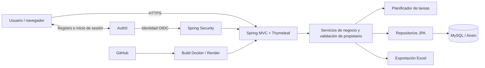

<div align="center">
  
</div>

# TaskScheduler

**Planificación semanal de tareas con rotación y acceso personal.**

TaskScheduler permite organizar áreas de trabajo, personal y tareas para generar planillas de asignación de hasta 52 semanas. Cada usuario tiene su propio espacio: configura sus equipos, consulta su historial y descarga los resultados en Excel.

El proyecto aborda un problema concreto: repartir tareas manualmente exige considerar quién puede realizarlas, evitar repeticiones innecesarias y distribuir el trabajo de manera equilibrada. La aplicación reúne esa configuración y automatiza la generación de la planilla.

**[Probar la aplicación](https://task-scheduler-app-demo-0-2.onrender.com/)** · **[Ver el código](https://github.com/AgustinG1/task-scheduler-DEMO-0.2)**

## Probar la demo

Entra desde la portada con Google o crea una cuenta mediante Auth0. Una cuenta nueva comienza sin registros y solo puede acceder a los datos que crea.

Para recorrer el flujo completo:

1. Crea las **áreas** de trabajo.
2. Registra **empleados** y asigna un área a cada uno.
3. Define **tareas generales** o **específicas**, indicando el área autorizada cuando corresponda.
4. Agrupa las tareas en un **catálogo**.
5. Crea un **equipo** y vincula sus áreas y catálogos.
6. Genera una **planilla de 1 a 52 semanas**, revisa la distribución y descarga el Excel.

La cuenta de demostración compartida conserva los datos de ejemplo; quienes acceden con esa misma cuenta comparten sus cambios. Las cuentas personales mantienen sus datos separados.

## Funcionalidades principales

| Función | Qué permite hacer |
| --- | --- |
| Acceso personal | Registrarse, iniciar sesión con correo o Google y cerrar sesión mediante Auth0. |
| Datos por usuario | Gestionar únicamente los registros propios, incluidas relaciones, planillas y descargas. |
| Áreas y empleados | Organizar el personal activo por área y retirarlo sin borrar sus asignaciones históricas. |
| Tareas y catálogos | Definir actividades generales o restringidas por área y reunirlas en catálogos reutilizables. |
| Equipos | Seleccionar las áreas y los catálogos que participan en una planificación. |
| Generación de planillas | Asignar tareas por semana según compatibilidad, cobertura y criterios de rotación. |
| Historial y Excel | Consultar planillas anteriores y exportar la distribución en formato `.xlsx`. |
| Interfaz adaptable | Usar listas con búsqueda, filtros y formularios en diálogo en Empleados, Tareas y Áreas, con distribución para escritorio y móvil. |

## Cómo funciona la asignación

El equipo determina qué empleados activos y qué tareas participan. El planificador respeta las autorizaciones y aplica estas prioridades:

1. **Cubrir la mayor cantidad posible de tareas compatibles.**
2. **Reducir repeticiones respecto de la semana anterior.**
3. **Priorizar tareas que la persona todavía no realizó en su ciclo.**
4. **Equilibrar tareas y descansos entre personas con las mismas autorizaciones.**

La asignación semanal utiliza una matriz de costes y una implementación del algoritmo húngaro. Después se buscan intercambios que mejoren la distribución sin empeorar las prioridades superiores.

Si la configuración obliga a repetir una tarea para mantener la cobertura, la repetición se permite. Si no hay personal compatible suficiente, la cobertura puede ser parcial. El equilibrado del período completo busca mejoras; no promete un óptimo global para cualquier configuración.

Cada nueva planilla inicia su propio ciclo de rotación. Hay **una planilla activa por usuario**: al generar otra, la anterior se archiva, aunque corresponda a un equipo distinto.

Implementación: [AssignmentAlgorithm](src/main/java/com/taskapp/task_scheduler/service/AssignmentAlgorithm.java) y [RotationPlanner](src/main/java/com/taskapp/task_scheduler/service/RotationPlanner.java).

## Tecnologías

| Capa | Tecnologías |
| --- | --- |
| Backend | Java 17, Spring Boot 4.0.6, Spring MVC y Spring Data JPA / Hibernate. |
| Interfaz | Thymeleaf, Bootstrap 5, CSS y JavaScript. |
| Autenticación | Spring Security, Auth0 y OpenID Connect sobre OAuth 2.0. |
| Persistencia | MySQL en producción y H2 en memoria para desarrollo y pruebas. |
| Exportación | Apache POI para archivos Excel. |
| Pruebas | JUnit, Spring Boot Test, MockMvc y Spring Security Test. |
| Construcción y despliegue | Maven, Docker, GitHub, Render y MySQL administrado en Aiven. |

## Arquitectura

Es una aplicación monolítica con vistas renderizadas en el servidor. Los controladores reciben las solicitudes, los servicios aplican las reglas de negocio y los repositorios acceden a la base de datos.



### Autenticación y propiedad de los datos

El login utiliza **Authorization Code** y una sesión mantenida por el servidor. La aplicación no implementa contraseñas propias ni exige guardar tokens en `localStorage`.

La identidad externa se vincula a un usuario local mediante el emisor y el identificador del proveedor. El acceso a los módulos exige correo verificado y cuenta activa. Las consultas y modificaciones comprueban el propietario; también se validan las relaciones entre registros. Las acciones de escritura utilizan protección CSRF.

El módulo [personal-auth-core](libraries/personal-auth-core) encapsula el acceso a la identidad OIDC para reutilizarlo en otras aplicaciones Java/Spring. La aplicación principal conserva sus reglas de negocio y propiedad de datos. [personal-auth-demo](libraries/personal-auth-demo) es un consumidor independiente de esa biblioteca.

## Ejecutar en local

### Requisitos

- JDK 17.
- Conexión a Internet para descargar dependencias y acceder a Auth0.
- Una aplicación web propia en Auth0 para probar el login local.
- PowerShell para utilizar el lanzador incluido. Maven Wrapper viene en el repositorio.

### 1. Clonar y construir

Desde una terminal PowerShell:

```powershell
git clone https://github.com/AgustinG1/task-scheduler-DEMO-0.2.git
cd task-scheduler-DEMO-0.2
.\mvnw.cmd -f workspace/pom.xml verify
```

El reactor construye y prueba la biblioteca de identidad, TaskScheduler y la demo independiente desde sus fuentes.

### 2. Configurar Auth0

En una aplicación de tipo **Regular Web Application**, configura estas URLs para el entorno local:

| Configuración | URL |
| --- | --- |
| Callback | `http://localhost:8080/login/oauth2/code/auth0` |
| Logout | `http://localhost:8080/` |

Habilita los métodos de acceso que quieras utilizar. La aplicación necesita un correo verificado para acceder a los datos.

### 3. Iniciar la aplicación

```powershell
.\Start-TaskScheduler.ps1
```

El lanzador solicita el issuer de Auth0 —con formato `https://TU_DOMINIO/`—, el Client ID y el Client Secret. El secreto se introduce de forma oculta y no se guarda en archivos. También admite las variables `AUTH0_ISSUER`, `AUTH0_CLIENT_ID` y `AUTH0_CLIENT_SECRET` definidas en el proceso.

Abre [localhost:8080](http://localhost:8080/). El lanzador activa los perfiles `local,auth0` y utiliza H2 en memoria: los datos locales se pierden al detener la aplicación.

Si necesitas otro puerto, usa `-Port 8081` y ajusta las dos URLs de Auth0 al mismo puerto.

En otros sistemas puedes ejecutar el JAR con las tres variables de Auth0 ya definidas:

```sh
sh ./mvnw -f workspace/pom.xml verify
java -jar target/task-scheduler-0.0.1-SNAPSHOT.jar --spring.profiles.active=local,auth0
```

## Pruebas

```powershell
.\mvnw.cmd -f workspace/pom.xml verify
```

La suite utiliza H2 e identidades OIDC sintéticas; no necesita las credenciales de Auth0 ni se conecta a producción. Incluye:

- Compatibilidad, cobertura, ciclos de rotación, descansos y repeticiones inevitables.
- Identidad, correo verificado, sesiones, logout y CSRF.
- Aislamiento entre dos usuarios en consultas, relaciones, modificaciones y descargas.
- Generación concurrente y conservación de una planilla activa por usuario.
- Callback HTTPS detrás de un proxy y acceso a los recursos CSS/JavaScript de las vistas.

También se realizaron comprobaciones manuales de login con dos cuentas, generación y exportación en Render/MySQL, además de ensayos de respaldo, restauración y migración.

## Despliegue

La demo se ejecuta como un contenedor Docker en **Render**, conectado a **MySQL en Aiven**, con los perfiles `prod,auth0`. Las credenciales se configuran mediante variables de entorno.

El [Dockerfile](Dockerfile) construye la biblioteca y la aplicación en una etapa Maven y ejecuta el JAR en una imagen Java 17. En producción se valida el esquema existente; las [migraciones de base de datos](database/migrations) son manuales y no se ejecutan al arrancar.

El archivo [docker-compose.yml](docker-compose.yml) ofrece un entorno local de MySQL y aplicación. Su configuración actual no incluye Auth0: permite comprobar el arranque, pero el acceso a los módulos permanece cerrado hasta configurar el proveedor. Para probar el flujo completo, utiliza el procedimiento local anterior.

## Alcance de esta versión

Esta versión está pensada como una demo de portfolio de planificación semanal de tareas. Cada usuario organiza sus propios registros; los empleados son recursos de planificación y no cuentas de acceso.

La planificación no incorpora horarios por hora, disponibilidad individual por fecha, vacaciones, cálculo de remuneraciones ni edición manual de la matriz generada. El historial conserva las planillas anteriores, pero no es una copia inmutable de los nombres y relaciones de sus registros.

## Qué demuestra el proyecto

- Modelado de un dominio relacional con áreas, empleados, tareas, equipos y planillas.
- Implementación de reglas de asignación con prioridades y pruebas de escenarios límite.
- Integración de identidad externa y autorización de datos por usuario en el servidor.
- Separación de una biblioteca reutilizable respecto de las reglas de la aplicación.
- Desarrollo de un flujo completo: configuración, generación, historial, exportación y despliegue.
